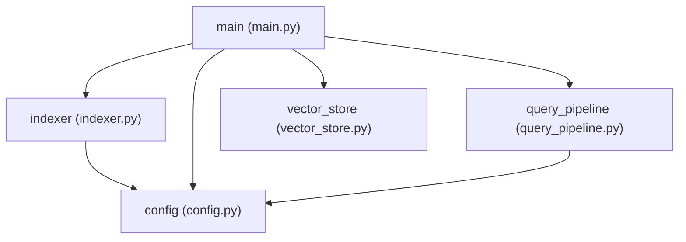

# Multi-Agent Code Helper — Full-Stack Integration
## Draw.io MCP + Deterministic Architecture Mapper + Code Change Analyzer

An AI-powered developer assistant that helps developers understand and maintain Python codebases using **Google ADK (Agent Development Kit)**, **NVIDIA NIM**, **Pinecone serverless vector retrieval**, and **Filesystem MCP**, integrated with the **official draw.io MCP server**, a **FastAPI backend**, and a modern **React + TypeScript + Vite frontend**.

---

## What It Does

Answers four fundamental developer questions about a Python codebase:

1. **Where is code?** — Find functions, variables, classes, and features (delegated to **Code Searcher** via custom Pinecone RAG).
2. **What does a file do?** — Explain complete source files (delegated to **Code Explainer** via **Filesystem MCP** and `read_project_file`).
3. **How is it connected?** — Inspect imports, modules, dependencies, and git changes (delegated to **Architecture Mapper** via a **genuinely NO-LLM deterministic Python AST engine** and **Draw.io MCP**).
4. **Where do I start?** — Understand setup requirements, entry points, and reading order (delegated to **Onboarding Guide**).

---

## Full-Stack Architecture

```
React + TypeScript Frontend (Port 5173)
        │
        │ HTTP JSON Requests + Server-Sent Events (SSE)
        ▼
FastAPI Integration Backend (Port 8001)
        │  [Input validation, Session tracking, Event normalization, CORS]
        │
        ▼
Google ADK API Server (Port 8000, App: "code_helper")
        │
        ▼
   Coordinator Agent (root_agent — LLM)
   ├── Code Searcher         [LLM]        --> Custom 5-stage RAG (Pinecone + NVIDIA nemotron-3-embed-1b)
   ├── Code Explainer        [LLM]        --> Filesystem MCP (@modelcontextprotocol/server-filesystem)
   ├── Architecture Mapper   [NO-LLM]     --> Deterministic Python AST Engine + Draw.io MCP Server
   └── Onboarding Guide      [LLM]        --> Verified repository structure & entry points
```

---

## Genuinely No-LLM Worker: Architecture Mapper

The **Architecture Mapper** is implemented as a custom Google ADK `BaseAgent` subclass (`ArchitectureMapperAgent`), **NOT** an `LlmAgent`.

### Key Deterministic Guarantees:
- **Zero LLM Inference**: No calls to NVIDIA, Pinecone, Gemini, or any chat model in its execution path.
- **Truthful Static Analysis**: Graphs and dependencies are constructed solely from source files using Python's `ast` standard library. It never hallucinates modules, classes, functions, or edges.
- **Controlled MCP Execution**: Invokes the official `@drawio/mcp` tools directly via standard MCP stdio client without LLM tool selection.
- **Offline Fallback**: If draw.io MCP is unavailable or unreachable, it produces a complete local Mermaid diagram and cleanly explains the service status.

### Deterministic Execution Pipeline:
```
User question routed to Architecture Mapper
    ↓
Parse request with explicit Python rules (keyword & regex matching)
    ↓
Read authorized Python source files (with path traversal guards)
    ↓
Analyze imports, functions, classes, and syntax errors using ast.parse & ast.walk
    ↓
Construct a module dependency graph (stable sorting for idempotency)
    ↓
Generate deterministic Mermaid diagram or draw.io XML
    ↓
Invoke draw.io MCP server directly via DrawioMCPClient (stdio: npx -y @drawio/mcp)
    ↓
Return verified architecture report and interactive Draw.io URL as ADK Event
```

---

## Official Draw.io MCP Server Integration

The project integrates the official draw.io MCP server:
- **Repository**: [https://github.com/jgraph/drawio-mcp](https://github.com/jgraph/drawio-mcp)
- **Subprocess Command**: `npx -y @drawio/mcp` (or `npx.cmd` on Windows)
- **Discovered Tools**:
  - `open_drawio_mermaid`: Opens diagrams in the draw.io editor generated from Mermaid.js syntax.
  - `open_drawio_xml`: Opens diagrams from native draw.io `mxGraphModel` XML.
  - `open_drawio_csv`, `list_pages`, `get_page`, `set_page`, `search_shapes`.

### Verified Diagram Example (`target_project`):


**Live Verified Draw.io Editor URL**:
`https://app.diagrams.net/?grid=0&pv=0&border=10&edit=_blank#create=%7B%22type%22%3A%22mermaid%22%2C%22compressed%22%3Atrue%2C%22data%22%3A%22Sy9KLMhQNTIIcVE1cATSQJScn5eWma5q6qRqZARlGxloQFh6BZWaQGFVU4TyzLyU1IrUIoh6GAeoAcrEoiM3MTMPohzMAqoF0VgUFpamFlXGF2QWpOZk5qVCtKCJATWjimAxpiw1uSS%2FKL4YSEANQREBGoHMx%2BNFIwNdXVVjV0QYofiIWFmYaTik0TyIQxWKD3CEF7qDAA%3D%3D%22%2C%22version%22%3A%2212%22%7D`

---

## Code Change Analyzer Skill

Located at `.opencode/skills/code-change-analyzer/SKILL.md`, this OpenCode project skill teaches the coding agent a 10-step, evidence-based change analysis procedure.

### Confidence Standards:
- `[Confirmed]`: Direct, verifiable facts from `git status`, `git diff`, or AST nodes.
- `[Likely]`: Inferred downstream impacts (e.g., caller modules, matching test files) requiring runtime confirmation.
- `[Unknown]`: Dynamic runtime behavior (reflection, dynamic imports) that static analysis cannot guarantee.

### 10-Step Workflow:
1. **Inspect Git Status**: `git status --porcelain=v1 -uall` (staged, unstaged, untracked).
2. **Inspect Unstaged Changes**: `git diff --no-color`.
3. **Inspect Staged Changes**: `git diff --cached --no-color`.
4. **Categorize Changed Files**: Added, Modified, Deleted, Renamed (`old -> new`).
5. **Read Relevant Source Context**: Focus strictly on modified regions and their immediate scopes.
6. **Compare Definitions via AST**: Detect added/removed functions, altered signatures, added/removed classes.
7. **Trace Downstream Callers & Dependencies**: Map which other project modules import modified files.
8. **Identify Regressions & Missing Coverage**: Identify signature breaks, new exceptions, or untested paths.
9. **Recommend Specific Validation Commands**: e.g., `pytest tests/test_<module>.py -v`.
10. **Deliver Evidence-Based Report**: Formatted cleanly with confidence labels.

### Sample Change-Analysis Report:
```markdown
### Code Change Analysis Report

#### 1. File Status Summary [Confirmed]
- **MODIFIED**: `target_project/config.py` (staged)
- **UNTRACKED**: `target_project/cache.py`

#### 2. Structural & AST Modifications [Confirmed]
- `target_project/config.py`:
  - Added function: `get_cache_ttl()`
  - Modified function: `load_config(env_path)` — added parameter `strict=False`

#### 3. Downstream Impact [Likely]
- Changes to `config` affect:
  - `target_project/indexer.py`
  - `target_project/query_pipeline.py`

#### 4. Recommended Validation Commands [Likely]
- `pytest tests/test_tools.py -v`
```

---

## Repository Structure

```
d:/deboistech/demo/
├── .opencode/
│   └── skills/
│       └── code-change-analyzer/
│           └── SKILL.md           # 10-step evidence-based change analysis skill
├── code_helper/                   # Google ADK multi-agent package
│   ├── __init__.py                # Exposes root_agent for ADK discovery
│   ├── agent.py                   # Coordinator + 4 worker agents
│   ├── architecture_agent.py      # Custom BaseAgent ArchitectureMapperAgent (NO-LLM)
│   ├── config.py                  # Model & Pinecone environment settings
│   ├── index_codebase.py          # CLI indexing script
│   ├── rag_pipeline.py            # Custom 5-stage RAG (no LangChain/LlamaIndex)
│   └── tools/                     # Python static analysis & MCP tools
│       ├── search_tools.py        # rag_search
│       ├── explain_tools.py       # read_project_file
│       ├── architecture_tools.py  # list_project_files, inspect_imports, build_graph, mermaid, xml
│       ├── drawio_client.py       # Deterministic @drawio/mcp client
│       ├── code_change_analyzer.py# Git status, diff, and AST change analyzer
│       └── onboarding_tools.py    # get_project_overview
├── backend/                       # FastAPI Integration Layer
│   ├── app/
│   │   ├── main.py                # FastAPI app with CORS & lifespan
│   │   ├── config.py              # Ports, hosts, ADK URL, allowed origins
│   │   ├── schemas.py             # Pydantic validation & normalized SSE schemas
│   │   ├── adk_client.py          # Async HTTPX client for ADK API server
│   │   ├── session_service.py     # Conversation sessions lifecycle
│   │   ├── event_adapter.py       # Normalizes ADK events into stable SSE protocol
│   │   └── routes/                # /api/health, /api/sessions, /api/chat/stream
│   ├── tests/                     # 15 backend tests
│   └── requirements.txt
├── frontend/                      # React + TypeScript + Vite + Tailwind CSS
│   ├── src/
│   │   ├── api/                   # Typed API client (health, sessions, SSE reader)
│   │   ├── components/            # Sidebar, ChatHeader, ChatMessageList, MessageComposer,
│   │   │                          # CodeBlock, SourceCard, AgentActivity, EmptyState
│   │   ├── types/                 # TypeScript interfaces
│   │   ├── App.tsx                # Main chat shell and state manager
│   │   └── test/                  # 12 Vitest + React Testing Library tests
│   ├── index.html
│   ├── vite.config.ts
│   └── package.json
├── target_project/                # The codebase being analyzed
│   ├── config.py
│   ├── indexer.py
│   ├── main.py
│   ├── query_pipeline.py
│   └── vector_store.py
├── tests/                         # 95 agent, tool, RAG, MCP, AST, and skill tests
├── requirements.txt               # Agent requirements
├── .env.example
└── README.md
```

---

## Local Development Port Map

| Component | Port | Config Variable | Default URL |
| :--- | :--- | :--- | :--- |
| **React Frontend** | `5173` | `VITE_API_BASE_URL` | `http://localhost:5173` |
| **FastAPI Backend** | `8001` | `BACKEND_PORT` | `http://127.0.0.1:8001` |
| **Google ADK API Server** | `8000` | `ADK_API_BASE_URL` | `http://127.0.0.1:8000` |

---

## The Five Primary Agents

| Agent | ADK Implementation | Type | Primary Responsibility |
| :--- | :--- | :--- | :--- |
| **Coordinator** | `coordinator` | `LlmAgent` | Receives user questions and delegates to the appropriate specialist. |
| **Code Searcher** | `code_searcher` | `LlmAgent` | Embeds query via NVIDIA NIM and retrieves matching code chunks from Pinecone. |
| **Code Explainer** | `code_explainer` | `LlmAgent` | Reads complete source files within `target_project/` via Filesystem MCP and explains logic. |
| **Architecture Mapper** | `architecture_mapper` | **Custom `BaseAgent` (NO LLM)** | Parses AST to discover imports, classes, functions, builds graphs, analyzes Git diffs, and opens Draw.io diagrams. |
| **Onboarding Guide** | `onboarding_guide` | `LlmAgent` | Details entry points, configuration requirements, and run commands. |

---

## Quickstart: Running the Complete Application

### 1. Environment Setup

Create `.env` in the project root:
```ini
NVIDIA_NIM_API_KEY=nvapi-...
NVIDIA_BASE_URL=https://api.nvidia.com/v1
NVIDIA_CHAT_MODEL=meta/llama-3.2-11b-vision-instruct
NVIDIA_EMBED_MODEL=nvidia/nemotron-3-embed-1b

PINECONE_API_KEY=pcsk_...
PINECONE_INDEX_NAME=code-helper
PINECONE_CLOUD=aws
PINECONE_REGION=us-east-1

ADK_API_BASE_URL=http://127.0.0.1:8000
ADK_APP_NAME=code_helper
BACKEND_PORT=8001
FRONTEND_ORIGIN=http://localhost:5173
```

### 2. Index the Codebase (One-time step)

```bash
python -m code_helper.index_codebase
```

### 3. Launch Services (3 Terminals)

#### Terminal 1: Google ADK API Server
```bash
python -m google.adk.cli api_server --port 8000 .
```

#### Terminal 2: FastAPI Integration Backend
```bash
python -m uvicorn backend.app.main:app --host 127.0.0.1 --port 8001 --reload
```

#### Terminal 3: React Frontend
```bash
cd frontend
npm run dev
```

Open `http://localhost:5173` in your browser.

---

## Running the Automated Test Suite

### Full Python Test Suite (110 Tests)
```bash
python -m pytest tests/ backend/tests/ -v
```

Test breakdown:
- `tests/test_config_and_agents.py`: Configuration and 5 ADK agent declarations.
- `tests/test_architecture_mapper_no_llm.py`: AST import extraction, deterministic stability, accurate edges, escaping, path restrictions, and verified execution with LLMs disabled.
- `tests/test_drawio_mcp.py`: Official draw.io MCP tool discovery, Mermaid/XML tool calls, URL extraction, timeout, and graceful failure fallbacks.
- `tests/test_code_change_analyzer.py`: AST comparison (functions, signatures, classes, imports), Git staged vs unstaged, added, deleted, and renamed files, path traversal rejection, downstream impact, and test recommendations.
- `tests/test_code_change_analyzer_skill.py`: Skill location, YAML frontmatter, and 10-step workflow verification.
- `tests/test_mcp_server.py`: Verified launching of Filesystem MCP via npx.
- `tests/test_rag_pipeline.py`: Stage 1 file ingestion & Stage 2 chunking boundaries.
- `tests/test_tools.py`: Deterministic tools (path traversal, AST extraction, overview).
- `backend/tests/test_backend.py`: Health, sessions, validation, and SSE streaming.
- `backend/tests/test_event_adapter.py`: ADK event normalization, token streaming, and source extraction.

### Full Frontend Test Suite (12 Tests)
```bash
cd frontend
npm run test
```
- `frontend/src/test/Components.test.tsx`: SourceCard, CodeBlock, AgentActivity, MarkdownContent, MessageComposer, EmptyState.
- `frontend/src/test/App.test.tsx`: Session lifecycle, streaming message updates, source references, error handling.

**Total automated tests passing:** **122 tests** (110 Python + 12 TypeScript).

---

## Security & Architectural Constraints

- **No Credential Leakage:** API keys reside strictly on the server in `.env` and are never delivered to client responses or stored in browser storage.
- **Path Traversal Protection:** All filesystem operations (`read_project_file`, Filesystem MCP, static analysis) are strictly confined to authorized directories. Traversal attempts (`../../`) are rejected.
- **Zero LLM in Static Architecture:** Architecture Mapper performs zero LLM, chat-model, embedding, or external AI API calls.
- **No Heavy RAG Frameworks:** Custom 5-stage RAG pipeline without LangChain or LlamaIndex.
- **Subprocess Safety:** All Git and MCP commands execute via explicit argument arrays without raw shell expansion.

---

## License

MIT